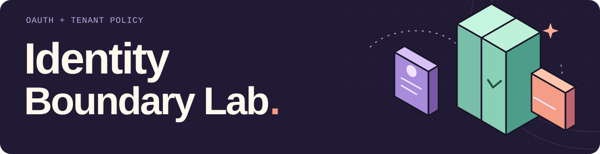
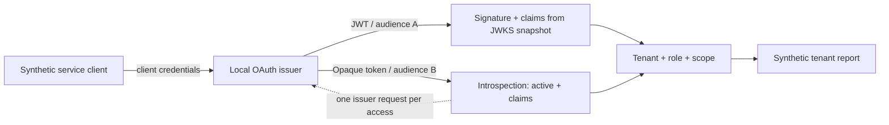

<picture>
  <source media="(max-width: 600px)" srcset="assets/readme-header-mobile.svg">
  
</picture>

A local **OAuth 2.0 token-boundary experiment**. Obtain actual client-credentials
tokens from `oidc-provider`, discover its keys over HTTP, and compare offline JWT
validation with online opaque-token introspection.

The API checks audience, expiry, tenant, role and scope before returning a
synthetic report. The demo makes one tradeoff visible: an online check sees an
opaque token's revocation; an offline verifier keeps accepting a separately
issued, unexpired JWT.

[Protocol & decisions](docs/protocol.md) · [HTTP contract](docs/api.md) ·
[Tests](tests) · [Assistance & verification](AI_ASSISTANCE.md)

## Run the experiment

Use **Node.js 24 LTS**, from the repository root. CI also targets Node 22.

```sh
npm ci --ignore-scripts
npm test
npm run demo
```

The demo starts a real local issuer and resource API on ephemeral loopback ports,
issues both tokens, exercises tenant/role failures, revokes the opaque token and
closes both servers. It uses no existing credentials, cloud service or paid API.

Selected fields from its actual output:

```json
{
  "beforeRevocation": {"offlineJwt": 200, "onlineOpaque": 200},
  "issuerCallsPerAuthorizedRequest": {"offlineJwt": 0, "onlineOpaque": 1},
  "crossTenant": {"offlineJwt": 403, "onlineOpaque": 403},
  "wrongRole": {"offlineJwt": 403, "onlineOpaque": 403},
  "opaqueRevocation": {"status": 200},
  "jwtRevocation": {"status": 400, "error": "unsupported_token_type"},
  "afterOpaqueRevocation": {"offlineJwt": 200, "onlineOpaque": 401},
  "jwtLifetimeSeconds": 60
}
```

**These are two different tokens for one synthetic client, with different resource
audiences.** This version of the upstream provider explicitly rejects JWT
introspection and revocation. The experiment preserves that protocol response;
it does not pretend that both validators checked the same JWT.

## Follow the boundary



| Check | JWT + offline verification | Opaque token + online introspection |
| --- | --- | --- |
| Token source | Actual OAuth client-credentials grant | Actual OAuth client-credentials grant |
| Trust boundary | RS256 signature, pinned issuer/audience/type, time claims | Authenticated introspection response, active state, pinned issuer/audience/time |
| API authorization | Tenant + `reader` role + `reports:read` scope | Same policy |
| Issuer calls per API access | 0, after startup discovery/JWKS | 1, with no result cache or retry |
| Revocation | Structured JWT revocation is unsupported by this issuer configuration | Issuer removes token state; the next check denies access |
| Issuer outage | A valid JWT can still verify against the cached keys | Fails closed with HTTP 503 |
| Key lifecycle | Startup JWKS snapshot; rotation requires API restart | Token state lives in the local issuer |

Tokens expire after at most 60 seconds. Signing keys and synthetic client secrets
are generated at startup and kept in memory. The issuer's development adapter is
also in memory; its warning is intentional. Restart loses opaque tokens and
client secrets. There is no persistence or shared multi-process issuer state.

## Inspect the actual HTTP services

```sh
npm start
```

This binds the issuer to `127.0.0.1:9100` and the API to `127.0.0.1:9101`.
`ISSUER_PORT` and `API_PORT` override those ports; `0` selects an ephemeral port.
The startup JSON prints addresses, without credentials, bearer tokens or private
keys.

```sh
curl -sS http://127.0.0.1:9100/.well-known/openid-configuration
curl -sS http://127.0.0.1:9101/healthz
```

For a small client you can change and rerun:

```sh
npm run build
node examples/client.mjs
```

That example starts its own isolated issuer/API, obtains tokens through the real
token endpoint and prints authorized response bodies. Change its requested tenant
to `beta`, or its client to `observer-alpha`, and inspect the 403 response.
The complete [HTTP contract](docs/api.md) lists endpoints and errors.

## Connect it to permission-aware RAG

[Enterprise AI Lab](https://github.com/edsonsims/enterprise-ai-lab#run-the-connected-rag-demo)
now uses this actual issuer for a Python RAG resource. It validates the original
JWT, queries a persistent Qdrant local store with real MiniLM embeddings, and
constructs the tenant/role filter before top-k and answer generation.

| Resource | Audience | Scope |
| --- | --- | --- |
| Original reports, offline | `urn:identity-boundary:reports:jwt` | `reports:read` |
| Original reports, online | `urn:identity-boundary:reports:opaque` | `reports:read` |
| Connected RAG, JWT only | `urn:identity-boundary:rag` | `rag:query` |

A reports token cannot authorize the RAG endpoint. Reader fixtures can retrieve
general tenant documents; analyst fixtures carry both `reader` and `analyst` roles
and can also retrieve that tenant's restricted notes. An observer token can be
issued, but the resource denies it. Scope and tenant checks remain necessary.

Run `npm run build` here, then follow the companion's
[one-command demo](https://github.com/edsonsims/enterprise-ai-lab#run-the-connected-rag-demo).
Its process harness starts `dist/bridge.js` through **private child stdio**. The
JSONL channel deliberately carries ephemeral access tokens to that parent; do not
pipe it to a public log or save its raw messages. Client secrets and private
signing keys stay inside the issuer process.

The RAG resource independently fetches discovery/JWKS and validates the JWT; it
trusts no identity headers injected by a gateway. Its
[design notes](https://github.com/edsonsims/enterprise-ai-lab/blob/main/docs/identity-rag.md)
cover permissions, index updates, offline token lifetime and generation limits.

## What the tests exercise

- Real discovery, public JWKS and client-secret authentication against the local issuer.
- Provider-issued JWT and opaque tokens, tenant separation, roles, scopes and revocation.
- Wrong issuer/audience/algorithm/signature/type, missing claims and expired tokens.
- Duplicate/malformed/oversized authorization headers and rejected query-token transport.
- Issuer outage, bounded response bodies/deadlines, redirect refusal and injected discovery endpoints.

Crypto-negative cases use controlled fixture signing keys to isolate each claim
check. They are separate from the positive cases that obtain tokens from the
actual provider. See [verification scope](AI_ASSISTANCE.md) for the tested runtime.

## Scope and next steps

Implemented: **machine-to-machine OAuth client credentials**, discovery/JWKS,
resource audiences, tenant/RBAC/scope policy and the two token-validation modes.

Planned: **browser sign-in/SSO, authorization code + PKCE, SAML, SCIM**, persistent
issuer storage and key rotation. Client credentials identify an application;
this milestone does not authenticate a person or implement browser SSO.

HTTP is confined to literal `127.0.0.1` with synthetic principals. This is an
engineering study, not a production identity service, compliance claim or a
certified OAuth/OIDC deployment. [Protocol notes](docs/protocol.md) document
availability, key-cache, revocation and transport limits.

[MIT license](LICENSE) · [Third-party notices](NOTICE) · [AI assistance](AI_ASSISTANCE.md)
